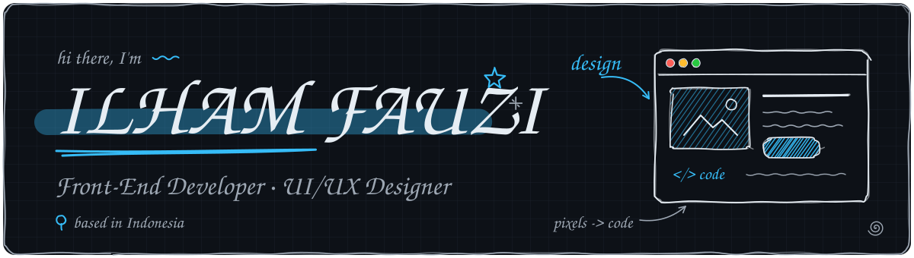
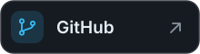
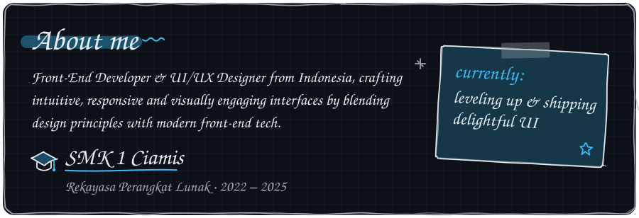
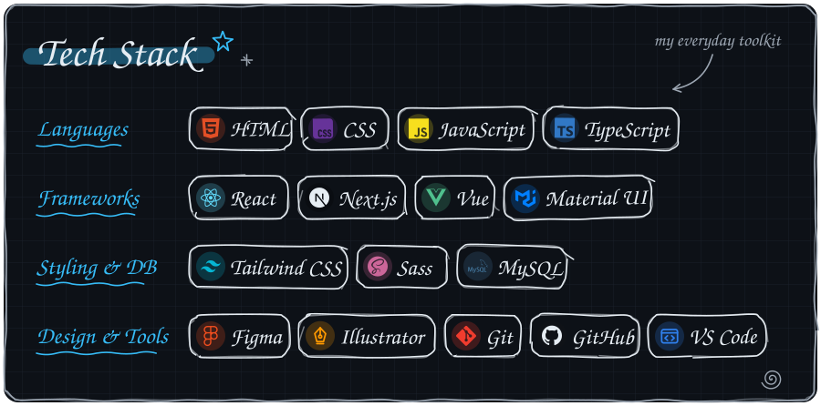
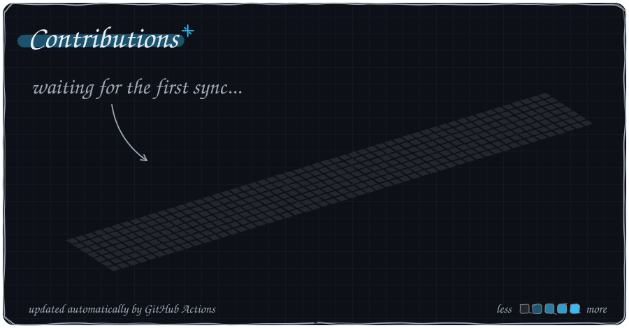
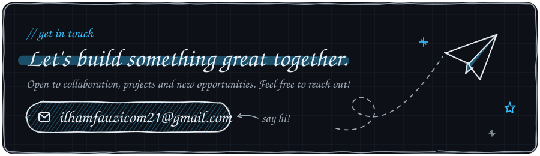

<!-- File ini dibuat oleh build.py dari profile.json. Edit data di sana, lalu jalankan: python3 build.py -->

<picture><source media="(prefers-color-scheme: dark)" srcset="assets/hero-dark.svg"><source media="(prefers-color-scheme: light)" srcset="assets/hero-light.svg"></picture>

  <a href="https://ilham-portfolio.framer.website/"><picture><source media="(prefers-color-scheme: dark)" srcset="assets/btn-portfolio-dark.svg"><source media="(prefers-color-scheme: light)" srcset="assets/btn-portfolio-light.svg"></picture></a>
  <a href="https://www.linkedin.com/in/ilhamfauzi-id"><picture><source media="(prefers-color-scheme: dark)" srcset="assets/btn-linkedin-dark.svg"><source media="(prefers-color-scheme: light)" srcset="assets/btn-linkedin-light.svg"></picture></a>
  <a href="mailto:ilhamfauzicom21@gmail.com"><picture><source media="(prefers-color-scheme: dark)" srcset="assets/btn-email-dark.svg"><source media="(prefers-color-scheme: light)" srcset="assets/btn-email-light.svg"></picture></a>
  <a href="https://github.com/amamFz"><picture><source media="(prefers-color-scheme: dark)" srcset="assets/btn-github-dark.svg"><source media="(prefers-color-scheme: light)" srcset="assets/btn-github-light.svg"></picture></a>

<picture><source media="(prefers-color-scheme: dark)" srcset="assets/about-dark.svg"><source media="(prefers-color-scheme: light)" srcset="assets/about-light.svg"></picture>

  

<picture><source media="(prefers-color-scheme: dark)" srcset="assets/stack-dark.svg"><source media="(prefers-color-scheme: light)" srcset="assets/stack-light.svg"></picture>

  

<picture><source media="(prefers-color-scheme: dark)" srcset="assets/calendar-dark.svg"><source media="(prefers-color-scheme: light)" srcset="assets/calendar-light.svg"></picture>

  

<a href="mailto:ilhamfauzicom21@gmail.com"><picture><source media="(prefers-color-scheme: dark)" srcset="assets/footer-dark.svg"><source media="(prefers-color-scheme: light)" srcset="assets/footer-light.svg"></picture></a>

